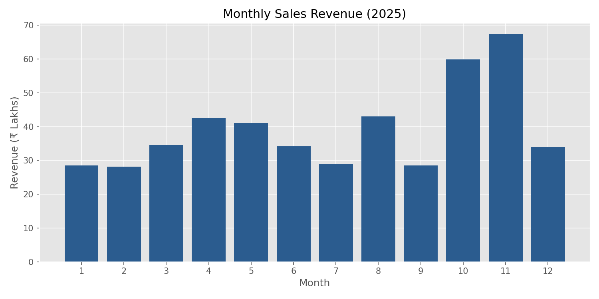
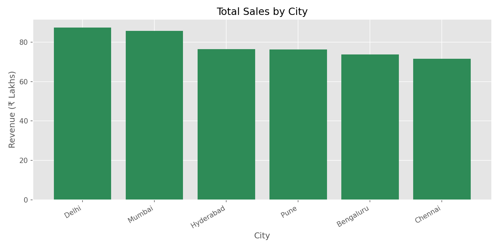
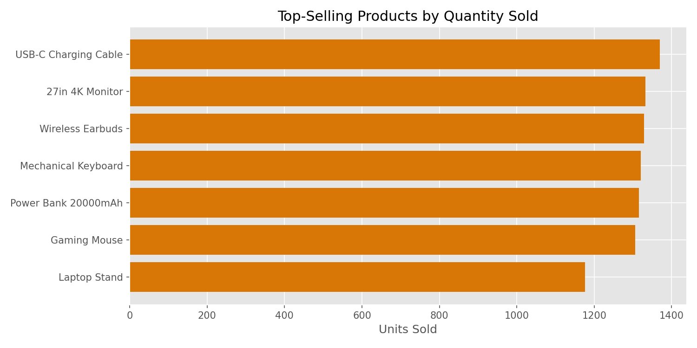

# Retail Sales EDA Using Python

An exploratory data analysis (EDA) project built with Python to consolidate 12 monthly sales CSV datasets, clean raw transaction records, and visualise revenue trends, regional sales, and product demand.

## Key Highlights
- **Data Consolidation:** Merged 12 monthly CSV files from `monthly_datasets/` into a single DataFrame.
- **Data Cleaning:** Removed missing entries, formatted dates and numeric fields, and derived `Month`, `City`, and `Sales` columns.
- **Business Insights:** Analysed seasonal revenue spikes, top-performing cities, and high-volume products.

## Tools & Libraries
- Python
- Pandas & NumPy
- Matplotlib

## Repository Structure
- `monthly_datasets/` — 12 monthly sales CSV files.
- `create_sales data.py` — Script to generate the monthly sales datasets.
- `retail sales eda.py` — Main analysis script for cleaning, aggregation, and plotting.
- `monthly_sales.png` — Monthly revenue breakdown.
- `sales_by_city.png` — City-wise sales comparison.
- `top_products.png` — Best-selling products by unit volume.

## Visualisations

### Monthly Revenue Trend

### City-Wise Sales Performance

### Top-Selling Products

